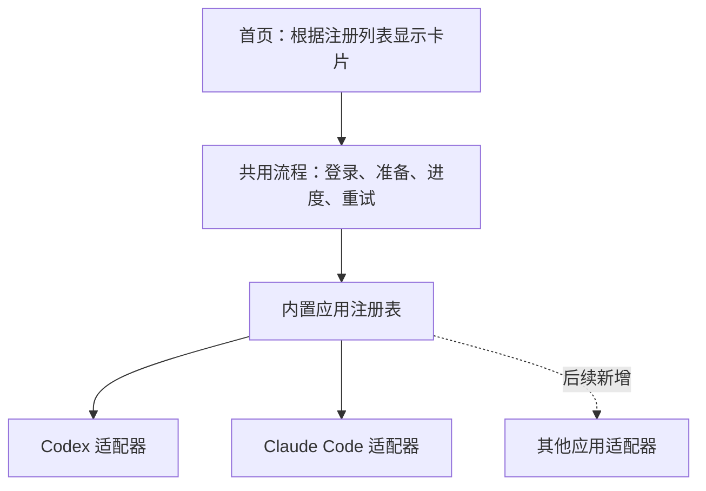

# TokenOne 桌面客户端方案

- 日期：2026-11-07
- 平台：macOS、Windows
- 首期工具：Codex CLI、Claude Code
- 基准项目：[CC Switch](https://github.com/farion1231/cc-switch)

实现进度：已按此范围建立 Tauri + React 工程，复用 CC Switch 的 JSONC 编辑器，配置和安装差异通过内置适配器隔离。没有继承上游全量供应商管理系统。运行方式与当前验证结果见 [README](../README.md)，真实授权与取 Key 的待接入项见 [接入说明](integration.md)。

## 1. 产品目标

**应用负责让用户的 AI 工具接上 TokenOne：登录 IDONE，点击启用，自动完成必要安装和配置。首版支持 Codex CLI 和 Claude Code，设计上支持后续增加其他应用。**

用户不需要理解 Base URL、API Key、配置文件、安装来源或模型协议。只支持 TokenOne 和对应工具的官方登录。

配置完成后，用户在原有终端或编辑器中使用工具，可以关闭本应用。首版不接管项目、终端和编程会话。

### 功能取舍原则

这里的“精简”指产品功能与用户决策少，文档应充分说明功能边界、失败处理和验收条件。

- 必须能直接对应登录、安装、配置或官方登录切换中的一项，才纳入首版。
- 同一个操作能自动完成的步骤，不拆成多个页面或多个按钮。
- 安装路径、默认模型、地址和凭据由程序处理，正常流程不让用户选择或填写。
- 配置备份、访问权限和错误处理是基础质量要求，在后台完成，不扩展为独立产品模块。
- 上游已有某项能力，不代表本产品需要展示或保留该能力。
- 应用数量可以扩展，用户流程保持一致；新增应用通过内置适配器接入，不增加新的管理流程。

### 首版只有四项用户功能

| 功能 | 用户操作 | 应用负责 |
| --- | --- | --- |
| IDONE 登录 | 点击登录，完成浏览器授权 | 获取与维护应用会话 |
| 安装与检测 | 无需单独操作 | 自动检测所选工具，缺失时安装，已有时复用 |
| 启用 TokenOne | 点击工具卡片的「启用 TokenOne」 | 获取 Key、备份、写配置、验证结果 |
| 使用官方登录 | 在工具卡片菜单中选择「使用官方登录」 | 移除 TokenOne 覆盖，复用或引导原生登录 |

退出、失败重试和撤销配置是以上功能的配套操作，不额外建立管理页面。

## 2. 用户操作：登录 → 启用 → 完成

1. 打开应用，通过浏览器登录 IDONE。
2. 点击 Codex 或 Claude Code 卡片上的「启用 TokenOne」。
3. 等待准备完成，看到「已连接 TokenOne」，随后按原有方式使用工具。

准备过程自动串联：检测安装 → 缺失时安装 → 获取 TokenOne Key → 备份并配置 → 验证连接。

- **只准备用户选中的工具**，不批量安装其他应用。
- 已有可用安装直接复用；不要求用户选择版本或安装方式。
- 默认提供「启用 TokenOne」操作，不让用户先选供应商、模型或接入模式。按钮附近说明「缺少工具时自动安装」，登录本身不修改本机工具配置。
- 已配置的工具显示完成状态。再次打开本应用不重复安装、写配置或发起模型测试。
- 不要求选择项目目录，也不维护最近项目或启动记录。
- 不自动更新已有工具；确实无法兼容时再提示修复。
- 官方登录、系统安装授权等必要交互仍由用户完成。

## 3. 界面：一个首页、应用卡片列表

首版列表包含 Codex CLI 和 Claude Code。卡片由已注册的应用信息生成，界面不写死两个工具；新增应用后使用相同的状态、按钮和操作流程。

```text
TokenOne                                  账号 ▾

选择要接入 TokenOne 的工具
缺少工具时自动安装

Codex CLI                Claude Code
未安装                   已连接 TokenOne
[启用 TokenOne] [⋯]      [已启用 ✓] [⋯]
```

每个工具只展示状态、至多一个可操作的主按钮和「更多」菜单。完成后显示状态，不要求用户再次点击。

| 状态 | 主按钮与反馈 |
| --- | --- |
| 未安装或未配置 | 启用 TokenOne |
| 准备中 | 显示「正在安装」「正在配置」等进度，防止重复点击 |
| 已连接 TokenOne | 已启用，不重复执行 |
| 使用官方登录 | 显示当前模式；主按钮仍可用于启用 TokenOne |
| 失败 | 重试；显示具体原因，详情中可复制脱敏错误信息 |

「更多」按当前状态提供「使用官方登录」和「撤销本应用的配置修改」。未来应用只有具备官方登录能力时才显示该入口。账号菜单仅显示当前账号与退出登录，不单独开发账户、额度或诊断页面。

选择「官方登录」后保留该选择，再次打开本应用不自动改回 TokenOne；已有官方登录直接复用，需要登录时调用工具原生流程。切换后提示重新打开工具，不自动中断正在运行的任务。

正常完成只显示结果及简短使用说明；失败时在当前卡片解释原因并提供重试。只在无法自动处理的冲突中展示进一步操作，不用连续弹窗引导正常流程。

## 4. 实现：复用 CC Switch，集中做少量改造

沿用前期调研的 CC Switch 选型，固定一个验证过的版本，复用其安装检测、配置读写与官方登录切换能力。保留现有代码中适用的应用抽象，将差异收敛到内置适配器；仅增加现有取 Key 协议要求的最小可信服务端模块。

| 必做改造 | 最小实现 |
| --- | --- |
| IDONE 登录 | 使用现有设备授权，浏览器确认，桌面自动查询；不需要本地回调端口 |
| TokenOne 接入 | 登录后通过现有接口获取调用 Key；内置已确认的地址和默认模型 |
| 一键启用 | 将检测、必要安装、配置和验证串成一个操作 |
| 应用适配 | 统一适配器接口，首版注册 Codex 和 Claude Code 两个实现 |
| 精简界面 | 一个首页，根据注册列表生成应用卡片和必要菜单 |
| 限定供应商 | 前端和后端仅允许官方、TokenOne，关闭其他预设与导入入口 |
| 发布 | 替换品牌、包标识和签名，提供 macOS、Windows 安装包 |

工具直接连接 TokenOne；协议适配放在 TokenOne 服务端。首版固定配置即可，暂不做远程配置中心。

首版移除上游自动更新入口，通过自己的下载页提供更新，避免安装回原版 CC Switch。保留上游适用的版权与许可证声明。

### 4.1 最小扩展结构



只保留三个清晰的职责边界：

| 部分 | 负责什么 |
| --- | --- |
| 共用流程 | IDONE 登录、TokenOne 凭据获取、步骤编排、进度与错误展示 |
| 应用注册表 | 稳定的应用 ID、名称、图标、支持平台、支持的接入模式以及适配器引用 |
| 应用适配器 | 该应用的检测、安装、配置、接入验证、官方登录切换和恢复规则 |

接入模式始终限定为 TokenOne 和官方；应用注册信息可以声明不支持官方登录，但不能引入其他中转站。

### 4.2 适配器接口边界

下表是职责约定，具体类型和命名优先贴合 CC Switch 的现有代码，不先做一套通用 SDK。

| 操作 | 适配器负责 | 共用流程获得 |
| --- | --- | --- |
| `detect` | 查找安装位置，识别是否可用和当前接入模式 | 安装与配置状态 |
| `install` | 执行该应用在当前平台的安装步骤 | 安装结果与进度 |
| `configure` | 按官方或 TokenOne 模式修改该应用配置，处理必要的原生登录 | 本次修改的恢复信息、是否需要用户完成登录或重新打开工具 |
| `verify` | 检查配置是否真正生效，验证应用对应的接入协议 | 可用结果或可解释的错误 |
| `restore` | 按本次修改记录恢复该应用配置，检查后续修改冲突 | 恢复结果 |

配置路径、文件格式、认证字段、默认模型和 TokenOne 端点映射留在各自适配器中，不能在首页或共用流程中散落 `if codex / if claude` 分支。共用流程按应用 ID 分发操作，不要求所有应用使用同一协议或同一 Key；凭据由共用服务按应用需要获取。

本地状态和备份按稳定的应用 ID 隔离，避免新增应用覆盖其他工具的记录。已有的权限控制、文件写入和日志脱敏工具可以复用，无需建立额外的存储服务。

### 4.3 新增一个应用需要做什么

1. 实现该应用适配器，补充平台、安装和配置规则。
2. 添加一条内置注册信息及该应用的 TokenOne 接入参数。
3. 验证安装、接入和恢复；具备官方登录能力时验证模式切换。
4. 随桌面应用的新版本发布，首页自动出现对应卡片。

正常新增应用不应修改 IDONE 登录、首页卡片组件或一键启用的共用流程。若新应用出现现有接口无法表达的实际需求，再做最小接口扩展。

首版不做动态加载、第三方插件、插件市场、用户自定义安装脚本或工作流引擎。扩展由项目开发者在代码中完成，保持产品和发布方式简单。

## 5. 配置和凭据：保留必要保障

- **自动配置**：按工具支持且验证通过的方式写入 TokenOne 地址、调用 Key 和默认模型。IDONE 登录令牌与模型调用 Key 分开。
- **凭据实现**：优先复用既有配置与凭据机制，首版不新增独立 Helper、设备密钥系统或自建凭据刷新协议。若工具配置需要保存 Key，限制为当前用户可访问，不额外复制到应用数据库。
- **保留原设置**：写入前备份，只修改接入相关字段，保留用户的 MCP、Hooks 和其他配置。
- **可恢复**：使用已有可靠写入机制；失败时恢复本次修改。恢复前检查用户是否又修改过，不能盲目用旧文件覆盖新配置。含凭据的备份同样限制访问。
- **正确切换**：切回官方时移除 TokenOne 覆盖项，保留官方登录。发现环境变量或项目设置冲突时说明原因，不静默改写无关设置。
- **避免泄露**：Key 和官方登录凭据不进入日志、错误复制内容或诊断上报；官方凭据不上传 TokenOne。
- **退出语义**：退出 IDONE 只退出本应用，菜单注明「不会清除工具配置」；用户可通过工具菜单恢复配置。

本应用关闭后，已经配置好的 CLI 应能继续使用，不依赖应用常驻。

供应商限制作用于本应用提供的接入配置；不尝试控制用户在应用外自行修改原版 CLI。

## 6. 首版暂不做

- 应用内聊天、代码编辑器、会话管理。
- 项目选择、最近项目、终端管理、工具启动管理。
- 第三方供应商、自定义 Base URL、本地代理、聚合与故障转移。
- 设备管理、密钥轮换后台、额度图表、独立诊断中心。
- 多版本管理界面、自动更新工具、自建应用更新服务。
- WSL、Windows ARM64、官方 Codex 桌面版和 Claude Desktop。

首版验证范围为 macOS Apple Silicon、macOS Intel 和 Windows x64 原生环境。增加功能以实际用户需求为依据。

这些能力不进入首版开发清单。首版建立上述内置应用适配器边界，不建设第三方插件体系、通用供应商模型或管理后台。

## 7. 开发顺序与验收

**先跑通，再精简，最后打包。**

1. 用选定的 CC Switch 版本，通过同一共用流程接入两个适配器，跑通 TokenOne 调用与官方登录往返切换。
2. 接入 IDONE 和自动取 Key，实现单页与一键启用，裁掉无关能力。
3. 在目标平台验证安装、配置、恢复及工具实际调用，生成签名安装包。

首版只围绕以下结果验收：

- 新用户登录后，只需点击所选工具的「启用 TokenOne」；准备过程中无需复制安装命令、填 Key 或编辑配置。
- 已安装工具能直接复用；再次打开本应用不重复准备。
- 两个工具均能通过 TokenOne 完成带工具调用的真实任务。
- 配置完成后关闭本应用，用户仍能在原有终端或编辑器中使用工具。
- 切回官方登录可用，用户原有配置不被破坏。
- 安装、网络或配置失败时原因清楚，可重试或恢复；不把写文件成功当作接入成功。
- 应用内没有可用的第三方供应商入口，日志和错误信息不泄露凭据。

产品验收同时检查：只有一个业务页面，没有项目、版本、设备、额度或供应商管理界面；正常配置流程没有要求用户决定安装方式、模型或配置路径的步骤。

扩展性验收检查：Codex 和 Claude Code 都通过注册表接入，复用同一套卡片和操作流程；平台支持与可用菜单由注册信息决定，配置和备份按应用隔离。通过代码审查确认新增同类应用只需适配器与注册信息，不为验收额外开发第三个真实应用。

不沿用原方案的固定工期估算，完成第 1 步后再按实际改造量排期。

## 8. 开工前只需确认的接口

1. **IDONE**：现有桌面授权如何接入，如何取得有效登录会话。
2. **TokenOne**：登录后如何获取调用 Key，以及两个工具各自的地址、默认模型和认证方式。

TokenOne 需要满足 Codex 的 Responses 调用和 Claude Code 的 Anthropic Messages 调用要求，以真实任务验证为准。若现有接口无法自动获取 Key，补一个最小接口，不扩展为设备管理平台。

已核对 CreativeOne：IDONE OIDC 登录、Reseller `keys/ensure` 及模型授权/兑换接口均已存在，具体请求与凭证边界见 [接入说明](integration.md)。现有 Reseller 应用凭证只适合受信服务端，因此 LaunchOne 需要最薄的发布方接入模块，不将共享凭证放进桌面包；该模块不转发模型请求，不增加产品管理功能。IDONE 已确认支持设备授权，客户端采用设备登录；模型授权仍使用服务端 HTTPS 回调。最小服务端和桌面衔接已实现，lab 测试账号已建立并完成 Reseller 登录；客户端/应用/回调/默认组的实际登记和 CLI 模型仍需完成，当前进度见 [lab 验收](lab-acceptance.md)。

当前选型沿用前期调研，尚未完成双平台真机和 TokenOne 实际联调。详细配置字段、最低工具版本在首个验证步骤中确定。

参考：[CC Switch](https://github.com/farion1231/cc-switch) · [Codex CLI](https://developers.openai.com/codex/cli/) · [Claude Code 安装](https://code.claude.com/docs/en/setup) · [Claude Code 网关](https://code.claude.com/docs/en/llm-gateway)
